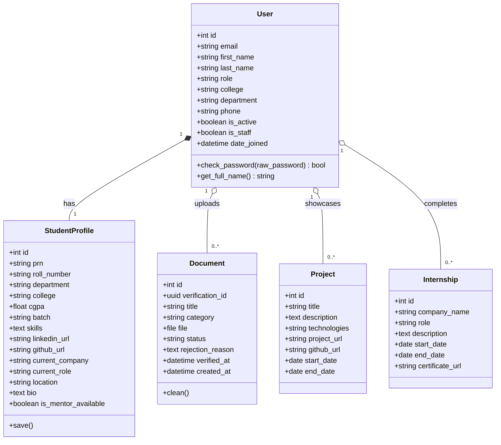
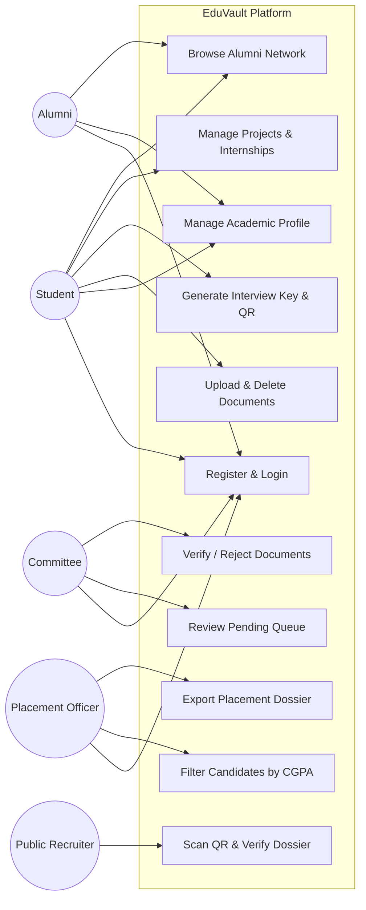
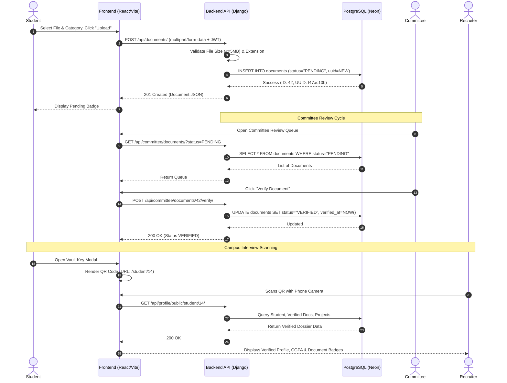
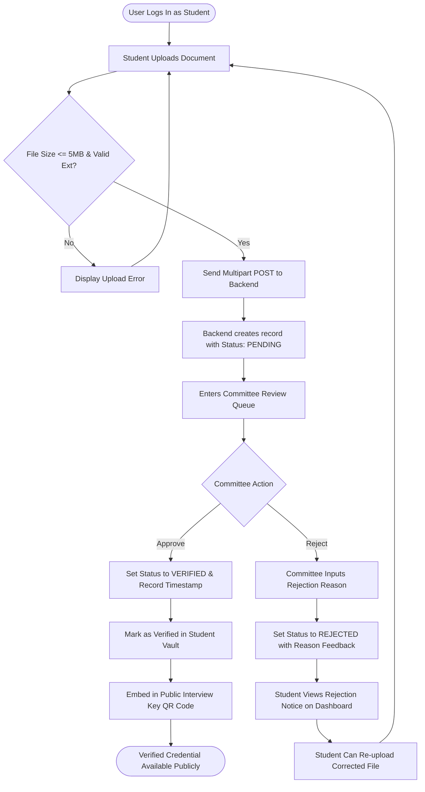

# Mini Project Report
## On
# **EduVault: Digital Locker and Academic Credential Verification Platform**

**By**
- **Member 1:** Akshay Darji — **PRN:** 1272250311
- **Member 2:** Priyesh Nandanwar — **PRN:** 1272250279

**For**
### **MCA40130 Mini Project**
### **SY MCA (Semester III)**
### **Academic Year: 2026-2027**

**Under the Guidance of**
### **Mrs. Sukanya Akolkar**

**Submitted To**
### **Dr. Vishwanath Karad MIT WORLD PEACE UNIVERSITY, PUNE**
*Technology, Research, Social Innovation & Partnerships*

In partial fulfillment of the requirement for the award of the Degree of  
**Master of Computer Applications (MCA)**

**Submitted Through**
### **School of Computer Science and Engineering**
### **Department of Computer Science and Applications**
**MIT-WPU, Kothrud, Pune - 411038**

---
<div style="page-break-after: always;"></div>

# Dr. Vishwanath Karad MIT WORLD PEACE UNIVERSITY, PUNE
### School of Computer Science and Engineering
### Department of Computer Science and Applications

<br/>

# **Certificate**

This is to certify that, **Akshay Darji** (PRN: 1272250311) and **Priyesh Nandanwar** (PRN: 1272250279), students of **SY MCA, Semester III** have completed the Mini Project entitled:

> ### **“EduVault: Digital Locker and Academic Credential Verification Platform”**

under the guidance of **Mrs. Sukanya Akolkar** in partial fulfillment of the requirement for the award of the degree of **Master of Computer Applications** prescribed under **Dr. Vishwanath Karad MIT World Peace University, Pune**.

This project is the record of authentic work carried out by them during the academic year **2026-2027**.

<br/><br/><br/>

**Mrs. Sukanya Akolkar**  
*Internal Guide*  
Department of Computer Science and Applications  
MIT-WPU, Pune  

<br/><br/>

| | |
| :--- | :--- |
| **Dr. P. S. Metkewar** | **Dr. Anuradha S. Kanade** |
| *Program Head - MCA* | *Program Director* |
| School of Computer Science and Engineering | School of Computer Science and Engineering |
| MIT-WPU, Pune | MIT-WPU, Pune |

---
<div style="page-break-after: always;"></div>

# **Acknowledgement**

**Date:** 27 / 10 / 2026  
**Place:** Pune  

We wish to express our profound gratitude to all the individuals who supported us throughout the completion of our **Mini Project III (MCA40130)**. This report is a testament to their guidance, patience, and valuable resources.

We are deeply indebted to our esteemed project guide, **Mrs. Sukanya Akolkar**, for her invaluable mentorship, direction, and continuous encouragement. Her advice was crucial in defining the scope, architectural framework, and methodology of this project.

We extend our sincere thanks to the Head of the Program, **Dr. P. S. Metkewar**, and the Program Director, **Dr. Anuradha S. Kanade**, for providing the necessary computing facilities, academic framework, and an environment conducive to advanced project development and research.

Our appreciation also goes to all the **Faculty Members of the Department of Computer Science and Applications** for their comprehensive instruction, technical insights, and expertise, which equipped us with the knowledge foundational to this project.

We thank our fellow classmates for their constructive feedback, user testing, and stimulating discussions, which enriched our understanding and helped us refine our system.

<br/><br/>

| Name | PRN | Signature |
| :--- | :--- | :--- |
| **Akshay Darji** | 1272250311 | ___________________________ |
| **Priyesh Nandanwar** | 1272250279 | ___________________________ |

---
<div style="page-break-after: always;"></div>

# **Declaration**

**Date:** 27 / 10 / 2026  
**Place:** Pune  

We, **Akshay Darji** and **Priyesh Nandanwar**, on behalf of our project team, hereby declare that this Mini Project report entitled:

> ### **“EduVault: Digital Locker and Academic Credential Verification Platform”**

is an authentic record of our own original work carried out under the supervision of **Mrs. Sukanya Akolkar**.

We further declare that the content of this report, including all system architecture, user interface design, backend API development, database design, cryptographic verification workflows, and testing, is original and has not been submitted previously for any other degree, diploma, or certificate at this or any other institution.

We take sole and full responsibility for any errors, omissions, or misrepresentations found within this report.

<br/><br/>

| Name | PRN | Signature |
| :--- | :--- | :--- |
| **Akshay Darji** | 1272250311 | ___________________________ |
| **Priyesh Nandanwar** | 1272250279 | ___________________________ |

---
<div style="page-break-after: always;"></div>

# **Project Report Index**

| Index | Section Title | Page No. |
| :---: | :--- | :---: |
| **1** | **INTRODUCTION** | **1** |
| 1.1 | Existing System, Proposed System and Need and Objective of System | 1 |
| 1.2 | Scope of Work | 3 |
| 1.3 | Operating Environment – Hardware and Software | 4 |
| 1.4 | Description of Technology Used | 5 |
| **2** | **PROPOSED SYSTEM** | **8** |
| 2.1 | Feasibility Study | 8 |
| 2.2 | User Requirements | 10 |
| **3** | **ANALYSIS AND DESIGN** | **12** |
| 3.1 | Object Diagram | 12 |
| 3.2 | Class Diagram | 13 |
| 3.3 | Use Case Diagram | 15 |
| 3.4 | Sequence Diagram | 17 |
| 3.5 | Activity Diagram | 19 |
| 3.6 | Module Hierarchy Diagram | 21 |
| 3.7 | User Interface Design (Screens etc.) | 22 |
| 3.8 | Table Specifications | 24 |
| **4** | **INPUT AND OUTPUT SCREENS** | **28** |
| **5** | **TEST PROCEDURES AND IMPLEMENTATION** | **33** |
| **6** | **SAMPLE CODE** | **37** |
| **7** | **LIMITATIONS** | **42** |
| **8** | **FUTURE SCOPE** | **43** |
| **9** | **CONCLUSION** | **44** |
| **10** | **REFERENCES** | **45** |

---
<div style="page-break-after: always;"></div>

# **1. INTRODUCTION**

## 1.1 Existing System, Proposed System and Need and Objective of System

### 1.1.1 Existing System
In contemporary universities and higher education institutes, academic credential storage, document validation, placement recruitment, and alumni relations operate in highly fragmented, manual, and unverified silos:
1. **Physical & Unsecured Digital Transcripts:** Students rely on paper certificates or unverified PDF scans that are vulnerable to forgery, tampered marks, or unauthorized alterations using graphic manipulation software.
2. **Cumbersome Administrative Verification:** Academic committees and verifiers manually cross-reference paper submissions against bulky physical archives, creating significant delays (often taking weeks for background checks).
3. **Disconnected Placement Workflow:** Campus Placement & Corporate Relations (TPO) teams manually compile candidate spreadsheets (CGPA, active backlogs, achievements, project URLs) which are frequently outdated or prone to student self-reporting errors.
4. **Isolated Alumni Networks:** Graduated alumni lose touch with their alma mater. Institutions maintain static, unsearchable contact registries rather than dynamic mentoring directories.

### 1.1.2 Proposed System — EduVault
**EduVault** is an enterprise-grade, role-governed **Digital Locker & Cryptographic Academic Verification Platform** that integrates four institutional pillars into a unified, cloud-hosted architecture:
- **Students:** Secure vault for storing degree certificates, transcripts, achievements, live project portfolios, and internship experiences. Features a 1-click cryptographic **Interview Key** and shareable QR code for instant recruitment verification.
- **Academic Verification Committee:** Dedicated institutional validation portal with real-time queues to inspect, approve, or reject submissions with granular rejection feedback and immutable verification timestamps.
- **Placement & Corporate Relations:** A dedicated recruiter-facing talent dashboard offering dynamic candidate filtering (by CGPA, department, graduation year, and verified document status) with direct access to comprehensive candidate dossiers.
- **Dynamic Alumni Network:** A searchable, filterable community connecting graduated students, allowing alumni to list current industry designations, companies, locations, and mentorship availability.

### 1.1.3 Need of the System
- **Combat Academic Credential Fraud:** Provides a single source of institutional truth where third-party recruiters can instantly verify the authenticity of student credentials without waiting for administrative mail exchanges.
- **Seamless Campus Placements:** Eliminates manual data compilation for corporate drives by exposing a verified talent pool with live academic dossiers.
- **Permanent Digital Vault:** Provides students with lifelong cloud access to their academic records, accessible on desktop and mobile devices.

### 1.1.4 Objectives of the System
- Develop a high-speed, secure **RESTful backend API** in Django REST Framework with role-based access control (RBAC) across 4 roles: `STUDENT`, `ALUMNI`, `COMMITTEE`, and `PLACEMENT`.
- Design an intuitive, responsive frontend using **React 18, Vite, and Tailwind CSS** that operates smoothly across modern browsers and mobile phones.
- Implement **UUID-based cryptographic verification tokens** and dynamic **QR Code generation** for physical and digital interview verification.
- Deploy the complete full-stack platform to 100% free production cloud infrastructure (Vercel for frontend, Render for backend web service, and Neon Serverless PostgreSQL for the persistent database).

---

## 1.2 Scope of Work

The scope of **EduVault** encompasses:
1. **User Authentication & Role Governance:** Secure registration, token-based authentication (JWT with access and refresh tokens), profile isolation, and automatic role redirection.
2. **Digital Document Vault (Student):** Document uploading (PDF, JPG, PNG up to 5 MB), category classification (`CERTIFICATE`, `MARKSHEET`, `INTERNSHIP`, `PROJECT`, `ACHIEVEMENT`, `OTHER`), real-time status tracking (`PENDING`, `VERIFIED`, `REJECTED`), and document deletion safeguards.
3. **Institutional Verification Pipeline (Committee):** Filterable review queue, in-app full-screen document previewer, approval execution, and rejection mechanism with feedback dispatched to the student.
4. **Talent Discovery Engine (Placement Team):** Live metrics on total talent pool, verified students, average CGPA, real-time departmental search, CGPA threshold filtering, and candidate profile drawer.
5. **Dynamic Alumni Directory:** Live database-driven registry with company, role, department, and mentorship availability filtering.
6. **Public Verification Gateway:** Open, authenticated endpoints allowing external interviewers to scan QR codes or open candidate links (`/student/:id` or `/verify/:verification_id`) to view verified records without institutional login credentials.

---

## 1.3 Operating Environment – Hardware and Software

### 1.3.1 Hardware Requirements

#### Development & Testing Environment
- **Processor:** Intel Core i5 / AMD Ryzen 5 or higher (Dual-Core 2.0 GHz minimum)
- **RAM:** 8 GB minimum (16 GB recommended)
- **Disk Space:** 500 MB free hard drive space for repository code and dependencies
- **Display Resolution:** 1366 x 768 minimum (1920 x 1080 Full HD recommended)
- **Network Interface:** Wi-Fi / Ethernet adapter with active internet connection

#### End-User Client Environment
- **Desktop/Laptop:** Any standard computer running Windows, macOS, or Linux with a modern web browser.
- **Mobile Device:** Android 8.0+ or iOS 13+ with camera for QR Code scanning.

---

### 1.3.2 Software Requirements

#### Operating System
- **Development:** Microsoft Windows 11 64-bit / Linux Ubuntu 22.04 LTS
- **Production Runtimes:** Linux-based cloud containers (Render Ubuntu runtime & Vercel Serverless Edge)

#### Development Tools & Environments
- **IDE:** Visual Studio Code / Antigravity IDE
- **Terminal Shell:** Microsoft PowerShell 7 / Bash Shell
- **Version Control:** Git 2.40+ & GitHub Cloud Repository

#### Runtime Engines & Frameworks
- **Backend Runtime:** Python 3.11.x
- **Backend Framework:** Django 6.0.x & Django REST Framework (DRF) 3.16.x
- **Frontend Runtime:** Node.js v20.x & npm 10.x
- **Frontend Tooling:** Vite 8.x (Bundler) & React 18.x
- **Database Engine:** PostgreSQL 16 (Hosted via Neon Serverless PostgreSQL)
- **WSGI Production Server:** Gunicorn 25.x with WhiteNoise 6.x

#### Web Browsers
- Google Chrome 110+, Mozilla Firefox 115+, Apple Safari 16+, or Microsoft Edge 110+

---

## 1.4 Description of Technology Used

```
+-----------------------------------------------------------------------+
|                         EduVault System Stack                         |
+-----------------------------------------------------------------------+
| Frontend:   React 18, Vite, Tailwind CSS, Lucide React, Axios, QRCode |
| Backend:    Python 3.11, Django 6.0, Django REST Framework, SimpleJWT  |
| Database:   PostgreSQL 16 (Neon Serverless Cloud)                     |
| Production: Vercel (SPA Frontend), Render (Gunicorn WSGI Service)     |
+-----------------------------------------------------------------------+
```

### 1.4.1 Frontend Technologies
- **React.js 18:** Component-driven declarative UI library enabling high-performance client-side rendering with reactive hooks (`useState`, `useEffect`, `useMemo`, `useRef`).
- **Vite:** High-performance frontend build tool utilizing native ES modules for sub-second development server startup and lightning-fast Rollup-based production builds.
- **Tailwind CSS:** Modern utility-first CSS framework facilitating responsive design, consistent design tokens, dark-mode styling, and micro-interactions without heavy CSS stylesheets.
- **Lucide React:** Clean, consistent SVG icon set providing intuitive visual affordances.
- **QRCode.react & QRServer API:** Generates cryptographic QR codes linking physical documents to live verification endpoints.
- **React Router DOM v6:** Declarative client-side routing, protected role-based routes, and dynamic URL parameter handling (`/student/:id`, `/verify/:id`).

### 1.4.2 Backend Technologies
- **Python 3.11:** Highly readable, robust, and secure programming language powering the application logic.
- **Django 6.0:** High-level Python web framework providing built-in ORM, security against CSRF/SQLi/XSS, and modular app design.
- **Django REST Framework (DRF):** Robust toolkit for crafting flexible, serializable RESTful APIs with parsers for `multipart/form-data` document uploads.
- **SimpleJWT (`rest_framework_simplejwt`):** Stateless JSON Web Token authentication system issuing signed access tokens and refresh tokens.
- **WhiteNoise:** Enables Gunicorn WSGI applications to serve their own static assets with gzip/brotli compression and persistent caching headers.
- **dj-database-url:** Utility allowing dynamic 12-factor database configuration using standard `DATABASE_URL` connection strings.

### 1.4.3 Database Technology
- **PostgreSQL 16 (Neon Serverless):** Advanced open-source Object-Relational Database Management System (RDBMS) providing full ACID compliance, foreign key cascade constraints, unique constraints, and high concurrent query throughput.

---
<div style="page-break-after: always;"></div>

# **2. PROPOSED SYSTEM**

## 2.1 Feasibility Study

A feasibility study assesses whether the proposed project is viable across operational, technical, and economic dimensions.

```
                   +---------------------------+
                   |     FEASIBILITY STUDY     |
                   +---------------------------+
                                 |
         +-----------------------+-----------------------+
         |                       |                       |
+-----------------+     +-----------------+     +-----------------+
|   Operational   |     |    Technical    |     |    Economic     |
|   Feasibility   |     |   Feasibility   |     |   Feasibility   |
+-----------------+     +-----------------+     +-----------------+
```

### 2.1.1 Operational Feasibility
- **User Adoption:** The system replaces slow paperwork with an intuitive interface. Students can upload marksheets within 30 seconds; committee members review submissions with a single click.
- **Role Alignment:** Distinct workflows prevent role ambiguity. Committee members see only pending documents; placement teams see aggregate student analytics; students only see their personal locker and public profile.
- **Mobile Compatibility:** By scanning QR codes, recruiters inspect verified dossiers on their mobile browsers without installing native mobile applications.
- **Conclusion:** The system is **operationally feasible** and requires no specialized user training.

### 2.1.2 Technical Feasibility
- **Proven Tech Stack:** Python, Django, React, and PostgreSQL are industry standards with active documentation and community support.
- **Security & Integrity:** Document uploads are protected by strict MIME-type and size validators. Passwords use PBKDF2 hashing with SHA-256 salts.
- **Containerization & Deployment:** The backend runs via Gunicorn WSGI, and the frontend compiles to static HTML/JS bundles hosted on global CDNs.
- **Conclusion:** The project is **technically feasible** using modern open-source stacks.

### 2.1.3 Economic Feasibility
- **Capital Expenditure (CapEx):** Zero licensing fees. Django, React, Vite, Tailwind CSS, and PostgreSQL are open-source.
- **Operational Expenditure (OpEx):** The platform is architected to operate on 100% free production cloud tiers:
  - **Vercel:** Free tier for static frontend hosting, global edge CDN, and SSL certificates.
  - **Render:** Free tier web service for running Gunicorn and Django REST backend.
  - **Neon.tech:** Free tier serverless PostgreSQL database with 0.5 GB storage and autoscaling compute.
- **Return on Investment (ROI):** Institutions eliminate paper archiving costs, courier fees for transcript verification, and manual placement coordination labor.
- **Conclusion:** The project is **economically feasible** with zero hosting and operational software costs.

---

## 2.2 User Requirements

### 2.2.1 Functional Requirements

| Requirement ID | Module / Role | Description |
| :---: | :--- | :--- |
| **FR-01** | **Authentication** | The system must allow users to register and log in with email and password, issuing signed JWT access and refresh tokens. |
| **FR-02** | **Role Allocation** | The system must support 4 distinct user roles: `STUDENT`, `ALUMNI`, `COMMITTEE`, and `PLACEMENT`. |
| **FR-03** | **Student Profile** | Students must be able to view and edit personal academic data (PRN, College, Department, CGPA, Batch, Skills, Bio). |
| **FR-04** | **Document Upload** | Students must be able to upload documents in PDF, PNG, or JPG format (≤ 5 MB) assigned to a specific category. |
| **FR-05** | **Document Lifecycle**| Documents must initiate in `PENDING` state and transition to `VERIFIED` or `REJECTED` exclusively via Committee actions. |
| **FR-06** | **Interview Key QR** | The system must generate a unique cryptographic URL and QR code for each student dossier (`/student/:id`). |
| **FR-07** | **Committee Review** | Committee members must be able to view, search, filter, preview, verify, or reject pending submissions with a reason. |
| **FR-08** | **Placement Portal**| Placement officers must be able to filter candidate pools by CGPA thresholds, departments, and verification statuses. |
| **FR-09** | **Alumni Network** | The system must provide a live searchable alumni directory with company, role, department, and mentorship status. |
| **FR-10** | **Public Dossier** | External visitors must be able to view verified candidate profiles and documents without logging into the system. |

### 2.2.2 Non-Functional Requirements

| Category | Metric / Specification |
| :--- | :--- |
| **Performance** | API endpoints must respond within 300 ms under normal load. Static frontend assets load in < 1 second via CDN. |
| **Security** | HTTPS encryption for all data in transit. Passwords hashed using PBKDF2 with SHA-256. Role permissions checked on every API call. |
| **Reliability** | Persistent cloud database with automated transaction rollback on query errors. |
| **Usability** | Fully responsive layout conforming to WCAG AA color contrast standards on mobile, tablet, and desktop screens. |
| **Maintainability**| Decoupled client-server architecture with clear separation between presentation, business logic, and persistence layers. |

---
<div style="page-break-after: always;"></div>

# **3. ANALYSIS AND DESIGN**

## 3.1 Object Diagram

The Object Diagram illustrates a snapshot of system objects, their attribute values, and runtime relationships during an active student verification session.

```mermaid
classDiagram
    direction LR

    object "akshayUser : User" as U1 {
        id = 14
        email = "ak12@gmail.com"
        role = "STUDENT"
        first_name = "Akshay"
        last_name = "Darji"
    }

    object "akshayProfile : StudentProfile" as SP1 {
        id = 7
        prn = "1272250311"
        department = "Computer Science"
        cgpa = 9.20
        batch = "2024-2026"
    }

    object "degreeDoc : Document" as D1 {
        id = 42
        title = "Degree Certificate"
        category = "CERTIFICATE"
        status = "VERIFIED"
        verification_id = "f47ac10b-58cc-4372a567"
    }

    object "committeeUser : User" as CU1 {
        id = 3
        email = "committee@mitwpu.edu.in"
        role = "COMMITTEE"
    }

    object "placementUser : User" as PU1 {
        id = 5
        email = "placement@mitwpu.edu.in"
        role = "PLACEMENT"
    }

    U1 --> SP1 : owns profile
    U1 --> D1 : uploads
    CU1 --> D1 : verifies
    PU1 ..> SP1 : views candidate
```

---

## 3.2 Class Diagram

The Class Diagram depicts the structure of the system by showing the application classes, their fields, methods, and relationships.



---

## 3.3 Use Case Diagram

The Use Case Diagram defines the interactions between the system actors (**Student**, **Alumni**, **Committee Member**, **Placement Officer**, and **Public Recruiter**) and their system use cases.



---

## 3.4 Sequence Diagram

The Sequence Diagram documents the end-to-end flow of a student uploading a credential, its verification by the academic committee, and subsequent scanning by a corporate recruiter.



---

## 3.5 Activity Diagram

The Activity Diagram portrays the decision logic executed during the document submission, verification, and rejection loop.



---

## 3.6 Module Hierarchy Diagram

The Module Hierarchy Diagram illustrates the top-down decomposition of the EduVault platform into modular components.

```mermaid
graph TD
    Root[EduVault Platform]

    Root --> ModAuth[1. Authentication & RBAC]
    ModAuth --> SubAuth1[User Registration]
    ModAuth --> SubAuth2[JWT Login & Token Refresh]
    ModAuth --> SubAuth3[Role-Based Route Guards]

    Root --> ModStudent[2. Student Digital Vault]
    ModStudent --> SubDocUpload[Document Management]
    ModStudent --> SubPortfolio[Projects & Internships Showcase]
    ModStudent --> SubVaultKey[Interview Key & QR Generator]

    Root --> ModCommittee[3. Committee Portal]
    ModCommittee --> SubQueue[Pending Document Queue]
    ModCommittee --> SubViewer[In-App Document Viewer]
    ModCommittee --> SubApprove[Verification & Rejection Engine]

    Root --> ModPlacement[4. Placement & Corporate Relations]
    ModPlacement --> SubMetrics[Talent Pool Analytics]
    ModPlacement --> SubFilter[CGPA & Department Filters]
    ModPlacement --> SubDossier[Candidate Dossier Viewer]

    Root --> ModAlumni[5. Alumni Network]
    ModAlumni --> SubAlumniDir[Searchable Directory]
    ModAlumni --> SubMentor[Mentorship Availability Filter]

    Root --> ModPublic[6. Public Verification Gateway]
    ModPublic --> SubPublicQR[QR Code Endpoint /student/:id]
    ModPublic --> SubCertVerify[Direct Cert Validator /verify/:id]
```



---

## 3.7 User Interface Design (Screens etc.)

EduVault follows a modern design system using Tailwind CSS, responsive CSS flexbox/grid containers, and accessibility principles:
1. **Authentication Screens (`/login`, `/register`):**
   - Clean, centered card layout with dual-panel branding.
   - Interactive role selector chips (`Student`, `Alumni`, `Committee Member`, `Placement Team`).
   - Real-time client-side validation for email syntax and password strength.
2. **Student Dashboard (`/dashboard`, `/certificates`, `/digital-locker`):**
   - Left collapsible navigation sidebar with active indicator pills.
   - Quick statistics cards (Total Documents, Verified Count, Pending Review, Placement Readiness).
   - Responsive document grid featuring file-type color tagging and verification status chips.
   - **Interview Key Widget:** Prominent QR Code preview card with a one-click modal expanding the full-resolution QR code for interviewer mobile scanning.
3. **Academic Committee Portal (`/committee/dashboard`, `/committee/documents`):**
   - Action-oriented interface highlighting backlog urgency.
   - Live queue table with filtering tabs (`ALL`, `PENDING`, `VERIFIED`, `REJECTED`).
   - Modal document inspection with embedded PDF viewer and side-by-side verification controls.
4. **Placement Portal (`/placement`):**
   - Analytical KPI header: *Total Talent Pool*, *Verified Candidates*, *Avg. Departmental CGPA*.
   - Filter bar with live text search, department dropdown, and quick-filter CGPA pills (`≥ 9.0`, `≥ 8.0`, `≥ 7.5`, `≥ 7.0`).
   - Candidate table with quick-view profile drawer showing student achievements and verified credentials.
5. **Dynamic Alumni Network (`/alumni`):**
   - Community card layout featuring profile avatars, company badges, job designations, and mentorship tags.
   - Instant search bar with department filters.
6. **Public Candidate Dossier (`/student/:id` & `/verify/:id`):**
   - Recruiter-focused, publicly accessible responsive portfolio without navigation bars.
   - Verified checkmark badges with institutional seals.

---

## 3.8 Table Specifications

The relational schema is implemented in PostgreSQL 16. Below are the data dictionary specifications:

### Table 1: `accounts_user` (Custom User Authentication Model)

| Column Name | Data Type | Constraints | Description |
| :--- | :--- | :--- | :--- |
| `id` | `BIGSERIAL` | Primary Key | Unique internal user ID |
| `email` | `VARCHAR(254)` | Unique, Not Null | Institutional or personal login email |
| `password` | `VARCHAR(128)` | Not Null | PBKDF2 with SHA-256 password hash |
| `first_name` | `VARCHAR(150)` | Not Null | Student / Staff first name |
| `last_name` | `VARCHAR(150)` | Not Null | Student / Staff last name |
| `role` | `VARCHAR(20)` | Not Null | Enum: `STUDENT`, `ALUMNI`, `COMMITTEE`, `PLACEMENT` |
| `college` | `VARCHAR(255)` | Not Null | Associated university/school name |
| `department` | `VARCHAR(100)` | Not Null | Academic department |
| `phone` | `VARCHAR(20)` | Nullable | Contact telephone number |
| `is_active` | `BOOLEAN` | Default True | Account operational status |
| `is_staff` | `BOOLEAN` | Default False | Administrative portal access flag |
| `date_joined` | `TIMESTAMPTZ` | Not Null | Timestamp of registration |

---

### Table 2: `students_studentprofile` (Academic Profile & Alumni Attributes)

| Column Name | Data Type | Constraints | Description |
| :--- | :--- | :--- | :--- |
| `id` | `BIGSERIAL` | Primary Key | Profile record ID |
| `user_id` | `BIGINT` | One-to-One, Foreign Key | Refers to `accounts_user.id` (ON DELETE CASCADE) |
| `prn` | `VARCHAR(50)` | Nullable, Indexed | Permanent Registration Number |
| `roll_number` | `VARCHAR(50)` | Nullable | Class roll identifier |
| `department` | `VARCHAR(100)`| Nullable | Specialized field of study |
| `college` | `VARCHAR(255)`| Nullable | Enrolled constituent institute |
| `cgpa` | `NUMERIC(4,2)`| Nullable | Cumulative Grade Point Average |
| `batch` | `VARCHAR(50)` | Nullable | Academic graduation batch (e.g. 2024-2026) |
| `skills` | `TEXT` | Nullable | Comma-delimited list of technical competencies |
| `linkedin_url`| `VARCHAR(200)`| Nullable | Public LinkedIn profile URL |
| `github_url` | `VARCHAR(200)`| Nullable | Public GitHub repository URL |
| `current_company`| `VARCHAR(150)`| Nullable | Employer name (Alumni specific) |
| `current_role` | `VARCHAR(150)`| Nullable | Job title / designation |
| `location` | `VARCHAR(100)`| Nullable | Current city/region |
| `bio` | `TEXT` | Nullable | Short professional summary |
| `is_mentor_available`| `BOOLEAN`| Default False | Willingness to mentor current students |

---

### Table 3: `documents_document` (Digital Locker Submissions)

| Column Name | Data Type | Constraints | Description |
| :--- | :--- | :--- | :--- |
| `id` | `BIGSERIAL` | Primary Key | Document internal identifier |
| `verification_id`| `UUID` | Unique, Not Null | Cryptographic UUID for QR & public lookup |
| `user_id` | `BIGINT` | Foreign Key | Owner reference to `accounts_user.id` |
| `title` | `VARCHAR(200)`| Not Null | Human-readable title of the certificate/marksheet |
| `category` | `VARCHAR(20)` | Not Null | Enum: `CERTIFICATE`, `MARKSHEET`, `INTERNSHIP`, `PROJECT`, `ACHIEVEMENT`, `OTHER` |
| `file` | `VARCHAR(100)`| Not Null | File path inside uploaded media directory |
| `status` | `VARCHAR(20)` | Not Null | Enum: `PENDING`, `VERIFIED`, `REJECTED` |
| `rejection_reason`| `TEXT` | Nullable | Feedback provided by committee upon rejection |
| `verified_at` | `TIMESTAMPTZ` | Nullable | Timestamp when committee approved the credential |
| `created_at` | `TIMESTAMPTZ` | Auto-Add | Upload creation timestamp |
| `updated_at` | `TIMESTAMPTZ` | Auto-Update | Last record modification timestamp |

---

### Table 4: `students_project` (Student Technical Projects Portfolio)

| Column Name | Data Type | Constraints | Description |
| :--- | :--- | :--- | :--- |
| `id` | `BIGSERIAL` | Primary Key | Project ID |
| `user_id` | `BIGINT` | Foreign Key | Refers to `accounts_user.id` (ON DELETE CASCADE) |
| `title` | `VARCHAR(200)`| Not Null | Project title |
| `description` | `TEXT` | Not Null | Comprehensive technical overview |
| `technologies` | `VARCHAR(255)`| Not Null | Tech stack used (e.g. React, Django) |
| `project_url` | `VARCHAR(200)`| Nullable | Live deployment URL |
| `github_url` | `VARCHAR(200)`| Nullable | Source code repository URL |
| `start_date` | `DATE` | Nullable | Project start date |
| `end_date` | `DATE` | Nullable | Project completion date |

---

### Table 5: `students_internship` (Industrial Experience Records)

| Column Name | Data Type | Constraints | Description |
| :--- | :--- | :--- | :--- |
| `id` | `BIGSERIAL` | Primary Key | Internship ID |
| `user_id` | `BIGINT` | Foreign Key | Refers to `accounts_user.id` (ON DELETE CASCADE) |
| `company_name` | `VARCHAR(200)`| Not Null | Employer organization |
| `role` | `VARCHAR(150)`| Not Null | Internship designation |
| `description` | `TEXT` | Nullable | Roles, duties, and contributions |
| `start_date` | `DATE` | Nullable | Start date |
| `end_date` | `DATE` | Nullable | End date |
| `certificate_url`| `VARCHAR(200)`| Nullable | Link to experience certificate |

---
<div style="page-break-after: always;"></div>

# **4. INPUT AND OUTPUT SCREENS**

Below is a detailed description of the input and output screens developed in EduVault:

### Screen 1: User Login & Role Gateway
- **Input Elements:** Email input field, password text box (with show/hide password toggle), submit button.
- **Output / Feedback:** JWT token storage in `localStorage`, error alerts for invalid credentials, automatic client redirection to role-specific dashboard (`/dashboard` for Student, `/committee/dashboard` for Committee, `/placement` for Placement Team).

### Screen 2: User Registration & Role Selection
- **Input Elements:** Full Name, Institutional Email, Password, Confirm Password, College Name, Department Name, Phone Number, and Role Selector Radio/Cards (`Student`, `Alumni`, `Committee Member`, `Placement Team`).
- **Output / Feedback:** Real-time form validation, green success banner upon account creation, transition to login.

### Screen 3: Student Digital Locker & Certificate Vault (`/certificates`)
- **Input Elements:** Drag-and-drop file upload zone (accepting `.pdf`, `.png`, `.jpg` up to 5 MB), Document Title text input, Category dropdown (`Certificate`, `Marksheet`, `Internship`, `Project`, `Achievement`).
- **Output / Feedback:** Upload progress indicator, updated document grid with color badges:
  - Yellow badge for `PENDING`
  - Green badge for `VERIFIED`
  - Red badge for `REJECTED` (with expand button showing reviewer feedback)
  - Action buttons: **View File** (opens directly from the backend media URL) and **Share / QR Code**.

### Screen 4: Interview Key & QR Code Modal
- **Input Elements:** "Interview Key" button on the student dashboard.
- **Output / Feedback:** High-resolution dynamic QR Code generating URL format: `https://eduvaul.vercel.app/student/{id}`, Candidate Name, PRN, and 1-click **Copy Verification Link** button.

### Screen 5: Academic Committee Review Queue (`/committee/documents`)
- **Input Elements:** Search bar (by title, student name, or email), status filter tabs (`PENDING`, `VERIFIED`, `REJECTED`), category selector dropdown.
- **Output / Feedback:** Interactive table showing student name, PRN, submission date, and actions:
  - **Review Button:** Opens an inspection drawer rendering the document in an embedded viewer.
  - **Approve Button:** Instantly executes status transition to `VERIFIED`.
  - **Reject Button:** Opens a modal prompting for specific feedback (e.g., "Blurry scan", "Missing official seal").

### Screen 6: Campus Placement Talent Pool (`/placement`)
- **Input Elements:** Global candidate search input, Department dropdown filter, Minimum CGPA filter pills (`All`, `≥ 9.0`, `≥ 8.0`, `≥ 7.5`, `≥ 7.0`), "Verified Credentials Only" toggle switch.
- **Output / Feedback:** Summary cards (*Total Talent Pool*, *Drive Eligible*, *Avg CGPA*), interactive candidate table with direct link to verified dossiers.

### Screen 7: Dynamic Alumni Network (`/alumni`)
- **Input Elements:** Real-time search by name, current employer, or job role; Department filter; "Available for Mentorship" checkbox filter.
- **Output / Feedback:** Responsive card grid showing alumni company badges, current role, location, bio, and "View Profile" link.

### Screen 8: Public Candidate Dossier (`/student/:id`)
- **Input Elements:** Public URL opened by recruiter via browser or QR scan.
- **Output / Feedback:** Read-only institutional verification dossier displaying student portrait, verified CGPA badge, institutional seal, approved documents with "View File" buttons, projects, and verified experience history.

---
<div style="page-break-after: always;"></div>

# **5. TEST PROCEDURES AND IMPLEMENTATION**

## 5.1 Testing Strategy
A multi-tier testing methodology was executed to validate functionality, security, responsiveness, and API integrity across client and server modules:
1. **Unit Testing:** Testing model constraints, serializer validations (e.g., file size <= 5MB, accepted extensions), and password hashing algorithms.
2. **Integration Testing:** Testing full HTTP request-response cycles, JWT generation, database queries, and role permission checks (`IsCommittee`, `IsPlacementOrCommittee`).
3. **Cross-Device Mobile Testing:** Validating responsive layouts and QR code camera scanning on physical mobile phones over Wi-Fi and production cloud URLs.
4. **End-to-End (E2E) System Testing:** Testing complete workflows from initial registration to document upload, committee approval, and public verification.

---

## 5.2 Test Cases & Execution Results

| Test ID | Test Scenario | Input Data | Expected Result | Actual Result | Status |
| :---: | :--- | :--- | :--- | :--- | :---: |
| **TC-01** | User Registration with Valid Data | Name: "Akshay Darji", Email: "ak12@gmail.com", Role: "STUDENT" | User record created, password hashed with PBKDF2 | User registered, HTTP 201 Created | **PASS** |
| **TC-02** | User Registration with Duplicate Email | Email: "ak12@gmail.com" (already registered) | Validation error: "A user with that email already exists." | Returned HTTP 400 with duplicate email error | **PASS** |
| **TC-03** | User Login with Correct Credentials | Valid Email & Password | Return signed JWT Access & Refresh tokens | HTTP 200 with tokens and user object | **PASS** |
| **TC-04** | User Login with Invalid Password | Correct Email, Wrong Password | Access denied, HTTP 401 Unauthorized | HTTP 401 with "No active account found" | **PASS** |
| **TC-05** | Document Upload within Size Limit | File: `marksheet.pdf` (1.8 MB), Category: `MARKSHEET` | File saved in media directory, status `PENDING` | File uploaded, HTTP 201 with status `PENDING` | **PASS** |
| **TC-06** | Document Upload Exceeding Size Limit | File: `large_portfolio.pdf` (8.4 MB) | Validation error: "File size must not exceed 5 MB." | HTTP 400 Bad Request, file rejected | **PASS** |
| **TC-07** | Document Upload with Disallowed Extension| File: `script.exe` or `data.zip` | Validation error: "Only PDF, JPG, JPEG, and PNG allowed." | HTTP 400 Bad Request, upload blocked | **PASS** |
| **TC-08** | Unauthorized Role Access to Committee Queue | Student JWT accessing `/api/committee/documents/` | Access forbidden, HTTP 403 | HTTP 403 Forbidden, redirected to dashboard | **PASS** |
| **TC-09** | Committee Document Verification | Committee user clicks "Verify" on Document ID: 42 | Status changes to `VERIFIED`, `verified_at` set to current time | Document status updated to `VERIFIED` | **PASS** |
| **TC-10** | Committee Document Rejection | Committee rejects with: "Missing college stamp" | Status changes to `REJECTED`, rejection reason saved | Status updated, student sees feedback | **PASS** |
| **TC-11** | Placement Candidate Filtering by CGPA | Filter: `CGPA >= 8.0`, Department: `Computer Science` | Returns only matching candidates meeting criteria | Correctly filtered candidate list rendered | **PASS** |
| **TC-12** | Mobile QR Code Scanning | Camera scans QR code from `/certificates` | Phone browser opens public dossier URL `/student/14` | Profile loaded on mobile with verified credentials | **PASS** |
| **TC-13** | Production Media File Serving | Recruiter clicks "View File" on cloud URL | Browser opens document from Render backend URL | Document opens directly in new tab | **PASS** |

---
<div style="page-break-after: always;"></div>

# **6. SAMPLE CODE**

### 6.1 Custom User Model & Role-Based Permissions (`accounts/models.py`)

```python
from django.contrib.auth.models import AbstractUser, BaseUserManager
from django.db import models


class UserManager(BaseUserManager):
    def create_user(self, email, password=None, **extra_fields):
        if not email:
            raise ValueError("The Email field must be set")
        email = self.normalize_email(email)
        user = self.model(email=email, **extra_fields)
        user.set_password(password)
        user.save(using=self._db)
        return user

    def create_superuser(self, email, password=None, **extra_fields):
        extra_fields.setdefault("is_staff", True)
        extra_fields.setdefault("is_superuser", True)
        return self.create_user(email, password, **extra_fields)


class User(AbstractUser):
    class Role(models.TextChoices):
        STUDENT = "STUDENT", "Student"
        ALUMNI = "ALUMNI", "Alumni"
        COMMITTEE = "COMMITTEE", "Committee Member"
        PLACEMENT = "PLACEMENT", "Placement Team"

    username = None
    email = models.EmailField(unique=True)
    role = models.CharField(max_length=20, choices=Role.choices, default=Role.STUDENT)
    college = models.CharField(max_length=255, default="MIT-WPU")
    department = models.CharField(max_length=100, default="Computer Science")
    phone = models.CharField(max_length=20, blank=True, null=True)

    objects = UserManager()

    USERNAME_FIELD = "email"
    REQUIRED_FIELDS = ["first_name", "last_name"]

    def __str__(self):
        return f"{self.email} ({self.role})"
```

---

### 6.2 Document Validation & Model Architecture (`documents/models.py`)

```python
import uuid
from django.conf import settings
from django.core.exceptions import ValidationError
from django.db import models


def validate_document_file(value):
    max_size = 5 * 1024 * 1024  # 5 Megabytes
    if value.size > max_size:
        raise ValidationError("File size must not exceed 5 MB.")

    allowed_extensions = [".pdf", ".jpg", ".jpeg", ".png"]
    file_name = value.name.lower()
    if not any(file_name.endswith(ext) for ext in allowed_extensions):
        raise ValidationError("Only PDF, JPG, JPEG and PNG files are allowed.")


class Document(models.Model):
    class Category(models.TextChoices):
        CERTIFICATE = "CERTIFICATE", "Certificate"
        MARKSHEET = "MARKSHEET", "Marksheet"
        INTERNSHIP = "INTERNSHIP", "Internship"
        PROJECT = "PROJECT", "Project"
        ACHIEVEMENT = "ACHIEVEMENT", "Achievement"
        OTHER = "OTHER", "Other"

    class Status(models.TextChoices):
        PENDING = "PENDING", "Pending"
        VERIFIED = "VERIFIED", "Verified"
        REJECTED = "REJECTED", "Rejected"

    user = models.ForeignKey(
        settings.AUTH_USER_MODEL,
        on_delete=models.CASCADE,
        related_name="documents"
    )
    verification_id = models.UUIDField(
        default=uuid.uuid4,
        unique=True,
        editable=False
    )
    title = models.CharField(max_length=200)
    category = models.CharField(max_length=20, choices=Category.choices)
    file = models.FileField(upload_to="documents/", validators=[validate_document_file])
    status = models.CharField(
        max_length=20,
        choices=Status.choices,
        default=Status.PENDING
    )
    rejection_reason = models.TEXT(blank=True, null=True)
    verified_at = models.DateTimeField(blank=True, null=True)
    created_at = models.DateTimeField(auto_now_add=True)
    updated_at = models.DateTimeField(auto_now=True)

    def __str__(self):
        return f"{self.title} - {self.user.email} [{self.status}]"
```

---

### 6.3 Committee Verification View (`documents/views.py`)

```python
from django.utils import timezone
from rest_framework import status
from rest_framework.response import Response
from rest_framework.views import APIView
from .models import Document
from .permissions import IsCommittee


class VerifyDocumentView(APIView):
    permission_classes = [IsCommittee]

    def post(self, request, pk):
        try:
            document = Document.objects.get(pk=pk)
        except Document.DoesNotExist:
            return Response(
                {"error": "Document not found."},
                status=status.HTTP_404_NOT_FOUND
            )

        document.status = Document.Status.VERIFIED
        document.verified_at = timezone.now()
        document.rejection_reason = None
        document.save()

        return Response(
            {
                "message": "Document verified successfully.",
                "verified_at": document.verified_at,
                "status": document.status,
            },
            status=status.HTTP_200_OK,
        )
```

---

### 6.4 Frontend Dynamic Media URL Handler (`eduvault-frontend/src/api/apiClient.js`)

```javascript
export const API_BASE_URL =
  typeof import.meta !== "undefined" && import.meta.env?.VITE_API_URL
    ? import.meta.env.VITE_API_URL.replace(/\/$/, "")
    : "";

/**
 * Resolves absolute URL for uploaded media files.
 * In production on Vercel, ensures relative /media paths target the Render backend.
 */
export const getMediaUrl = (url) => {
  if (!url) return "";
  if (url.startsWith("http://") || url.startsWith("https://")) {
    return url;
  }
  const cleanPath = url.startsWith("/") ? url : `/${url}`;
  return `${API_BASE_URL}${cleanPath}`;
};
```

---
<div style="page-break-after: always;"></div>

# **7. LIMITATIONS**

While EduVault provides a comprehensive, end-to-end digital locker and verification ecosystem, certain constraints and limitations exist in the current version:
1. **Cloud Free-Tier Spin-Down (Cold Starts):** On Render's free tier, the backend container spins down after 15 minutes of inactivity. When a request arrives after sleep, the container requires 30–50 seconds to initialize.
2. **Ephemeral File Storage on Render Free Tier:** Render free instances use an ephemeral filesystem. While the PostgreSQL database on Neon is permanent, locally stored media files reset upon full container restarts unless linked to external cloud storage (e.g., AWS S3 or Cloudinary).
3. **Manual Committee Review:** Verification relies on authorized human committee inspection. Automated Optical Character Recognition (OCR) against institutional registries is not yet integrated.
4. **Offline Capability:** The system requires an active internet connection to authenticate and verify records; an offline progressive web app (PWA) cache is not currently enabled.

---

# **8. FUTURE SCOPE**

The architectural design of EduVault allows for scalable future enhancements:
1. **Decentralized Blockchain Verification (Ethereum / Polygon):**
   - Hashing approved certificates (SHA-256) and anchoring the cryptographic hashes onto public smart contracts for tamper-proof, decentralized verification.
2. **Persistent Cloud Object Storage:**
   - Seamless integration with Amazon S3 or Cloudinary to provide persistent, geographically replicated media storage across container lifecycles.
3. **AI-Powered Automated Credential OCR:**
   - Integrating Google Vision API / Tesseract OCR to cross-reference extracted student PRN, names, and grades directly against university ERP records, automating 80% of routine verifications.
4. **Institutional Digilocker & NAD Integration:**
   - Interfacing with the Government of India's National Academic Depository (NAD) and DigiLocker APIs for direct credential import.
5. **Mobile Native Applications:**
   - Packaging the client using React Native or Flutter for Android and iOS app store releases with offline biometrics.

---
<div style="page-break-after: always;"></div>

# **9. CONCLUSION**

The **EduVault: Digital Locker and Academic Credential Verification Platform** successfully solves the long-standing challenges of academic credential fraud, slow administrative verification, and fragmented campus placement workflows.

By implementing a modern client-server architecture using **Django REST Framework, React 18, Vite, Tailwind CSS, and Neon Serverless PostgreSQL**, the platform establishes a single institutional source of truth. Key accomplishments include:
- Complete role-based governance across **Students, Alumni, Academic Committee, and Placement Officers**.
- Instant physical-to-digital validation via dynamic **QR-coded Interview Keys** (`/student/:id`).
- Streamlined corporate placement operations with real-time candidate search and CGPA filtering.
- Fully operational, zero-cost production deployment on **Vercel** and **Render**.

EduVault proves that institutional workflows can be modernized into an intuitive, secure, and accessible platform, establishing a solid foundation for future academic management and recruitment standards.

---
<div style="page-break-after: always;"></div>

# **10. REFERENCES**

### 10.1 Books & Publications
1. **Two Scoops of Django 3.x:** *Best Practices for the Django Web Framework* – Daniel Roy Greenfeld & Audrey Roy Greenfeld.
2. **Learning React:** *Modern Patterns for Developing React Apps (2nd Edition)* – Alex Banks & Eve Porcello, O'Reilly Media.
3. **Designing Data-Intensive Applications:** *The Big Ideas Behind Reliable, Scalable, and Maintainable Systems* – Martin Kleppmann, O'Reilly Media.

### 10.2 Technical Documentation & Specifications
1. **Django Project Documentation (v6.0):**  
   URL: [https://docs.djangoproject.com/en/6.0/](https://docs.djangoproject.com/en/6.0/)
2. **Django REST Framework Guide:**  
   URL: [https://www.django-rest-framework.org/](https://www.django-rest-framework.org/)
3. **React 18 Official Documentation:**  
   URL: [https://react.dev/](https://react.dev/)
4. **Vite Frontend Tooling Guide:**  
   URL: [https://vite.dev/guide/](https://vite.dev/guide/)
5. **Tailwind CSS Documentation:**  
   URL: [https://tailwindcss.com/docs](https://tailwindcss.com/docs)
6. **PostgreSQL 16 Reference Manual:**  
   URL: [https://www.postgresql.org/docs/16/index.html](https://www.postgresql.org/docs/16/index.html)
7. **JSON Web Token (JWT) Standards (RFC 7519):**  
   URL: [https://datatracker.ietf.org/doc/html/rfc7519](https://datatracker.ietf.org/doc/html/rfc7519)
